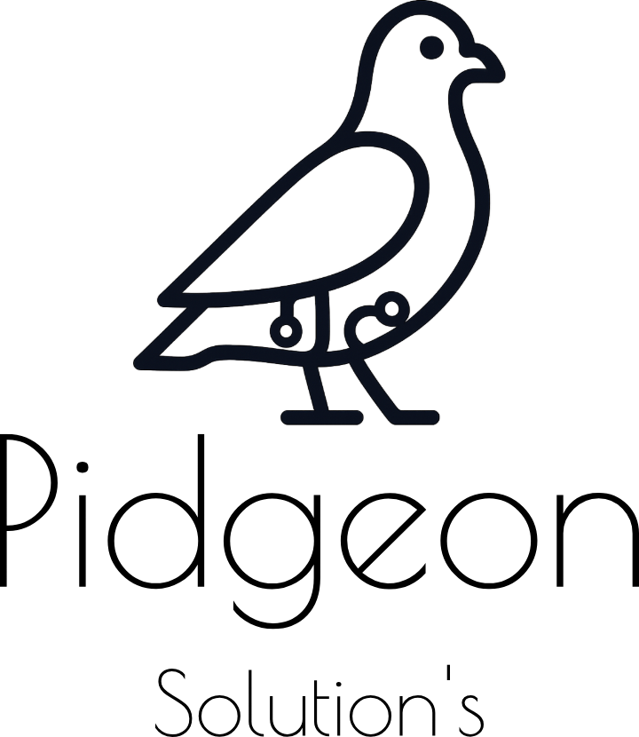

<div align="center">
  

  <h1>Pidgeon Solutions</h1>

  <p><strong>Emprendimiento Tecnológico · Chatbots con IA, GovTech, Software Enterprise y Automatización</strong></p>

  
  
  
  
  
  

</div>

---

## 🧠 Sobre el Proyecto

**Pidgeon Solutions** (`pidgeonsolutions.tech`) es un estudio de software fundado por **Brian Benegas y sus socios** (Gastón Alejandro), enfocado en desplegar agentes conversacionales con IA, portales GovTech, sistemas a medida y automatizaciones.

Este repositorio contiene:

- **Frontend SPA (`client/`)** — Landing page en Svelte 5 y Tailwind CSS v4 con sistema bilingüe (`ES`/`EN`), carrusel interactivo de **Chatbots con IA** (`ChatbotShowcase.svelte`) y widget de asistencia en vivo (`ChatWidget.svelte`) con streaming por chunks.
- **Backend API (`backend/`)** — Servicio NestJS liviano para proxy de Google Gemini con cadena de modelos fallback, envío de contacto vía SMTP y rate-limiting por IP sobre Redis propio.
- **Infraestructura (`docker-compose.yml`)** — 3 servicios aislados en la red `pidgeon-net`: `client` (`:3002`), `backend` (`:4001`) y `redis` (`redis:7-alpine`).

---

## 🚀 Puesta en Marcha

```bash
# Levantar o actualizar en producción
docker compose up -d --build
```

## 👥 Equipo

- **Brian Benegas** — Tech Lead & Infraestructura
- **Gastón Alejandro** — Operaciones & Estrategia
