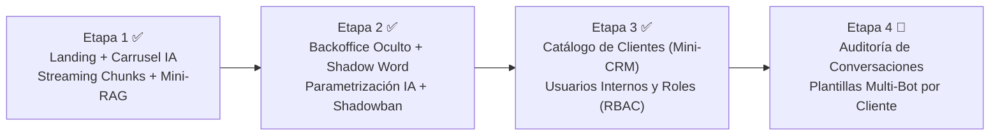

# Planroad — Mapa de Ruta de Pidgeon Solutions (`pidgeonsolutions.tech`)

Este documento define la evolución por etapas de la plataforma de **Pidgeon Solutions** (emprendimiento tecnológico de **Brian Benegas**, **Thomas Pineda** y **Gastón Alejandro**), manteniendo siempre una landing pública limpia, veloz y sin fricción para el visitante, respaldada por un **Backoffice Oculto** inspirado en la arquitectura de `brianleft-portfolio`.

---

## Visión General de Etapas

---

## Etapa 1: Base en Línea, Carrusel de Chatbots IA y Mini-RAG Inicial *(Completada)*
- **Aislamiento de infraestructura:** Red Docker propia (`pidgeon-net`) y contenedor `redis:7-alpine` exclusivo para Pidgeon Solutions.
- **Carrusel de Chatbots con IA (`ChatbotShowcase.svelte`):** 4 demos interactivas con auto-avance cada 20s, sincronización de viewport (`IntersectionObserver`), respuestas transmitidas por chunks y **GovTech en último lugar (`04 / 04`)**.
- **Chatbot Real (`ChatWidget.svelte` + `ChatService`):** Streaming SSE por chunks (2–4 caracteres cada 15ms), cadena de modelos fallback de Google Gemini y renderizado Markdown limpio (`breaks: true, gfm: true`).
- **Equipo:** Brian Benegas (*Tech Lead & Infraestructura*), Thomas Pineda (*Director Creativo*) y Gastón Alejandro (*Operaciones & Estrategia*).

---

## Etapa 2: Backoffice Oculto, Shadow Word, Parametrización del Chatbot y Shadowban *(Implementada)*
- **Acceso Oculto por Shadow Word (`/shadow`):**
  - Sin ningún botón de login público en la landing.
  - Al escribir la *Shadow Word* en el input de `ChatWidget.svelte`, el widget intercepta el comando localmente (sin enviarlo a Gemini ni guardarlo en `localStorage`), solicita usuario y contraseña enmascarada (`••••••`) y abre `AdminBackoffice.svelte`.
  - El usuario inicial `SUPERADMIN` (`brianleft`) se reconcilia automáticamente desde `.env` mediante un seeder idempotente con hash `scrypt`.
- **Persistencia Liviana (`SQLite` nativo en volumen Docker `pidgeon-data`):**
  - Cero consumo adicional de RAM en el VPS (`/app/data/pidgeon.sqlite`).
- **Parametrización en Caliente del Chatbot:**
  - **Memorias RAG (`memories`):** Alta, edición, activación/desactivación, prioridad y `keywords` de cada bloque de conocimiento (`base`, `planes`, `chatbots`, `tecnologia`, `faq-proceso`, etc.).
  - **Personalidad y Directivas (`ai_config`):** Edición en vivo de `system_prompt`, `plans_directive`, `final_directives_es`, `final_directives_en`, `temperature` y cadena de modelos Gemini.
  - **Placeholders Comerciales (`settings`):** Variables `{{plan_emprendedor_mo}}`, `{{plan_pyme_mo}}`, `{{plan_medida_from}}`, `{{offer_discount}}`, `{{whatsapp_number}}`, `{{support_email}}`, etc., que hidratan las memorias en cada consulta.
- **Shadowban de IPs (`shadowbans`):**
  - Permite marcar IPs abusivas o bots para que reciban una respuesta señuelo transmitida por chunks sin invocar a la API de Google Gemini ni gastar cuota.

---

## Etapa 3: Catálogo de Clientes (Mini-CRM), Usuarios Internos y Roles (RBAC) *(Implementada)*
> **Nota:** Las tablas `users` y `clients` operan en SQLite con consultas parametrizadas (`node:sqlite`), el formulario de contacto registra automáticamente cada consulta entrante como `LEAD`, y `AdminBackoffice.svelte` expone el ABM interactivo de socios y clientes.

### 3.1. Usuarios y Roles Internos (`RBAC`)
| Rol | Destinatarios | Permisos |
|---|---|---|
| `SUPERADMIN` | Brian Benegas (`brianleft`) | Control total: Memorias RAG, Prompts IA, Modelos, Shadowban, Usuarios/Roles y Catálogo de Clientes. |
| `PARTNER` | Socios (Thomas Pineda `@thomas`, Gastón Alejandro `@gaston`) | Gestión completa del Catálogo de Clientes/Leads, Parámetros comerciales (`settings`), Memorias RAG y métricas. |
| `SALES` | Equipo comercial / operadores | Gestión de Leads entrantes, cambio de estado comercial (`LEAD` → `DEMO` → `ACTIVE`), notas de seguimiento y alta de clientes. |
| `VIEWER` | Colaboradores / consulta | Lectura del catálogo de clientes y estado de proyectos. |

### 3.2. Catálogo de Clientes y Leads (`clients`)
- **Captura automática:** Todo mensaje enviado desde el formulario de contacto (incluso si SMTP aún no está configurado) se guarda automáticamente en la tabla `clients` con estado `LEAD`.
- **Ficha de Cliente (ABM en `AdminBackoffice.svelte`):**
  - Datos de contacto: Nombre, Empresa/Organización, Email, WhatsApp/Teléfono.
  - Plan de interés o contratado: `Emprendedor`, `Pequeña Empresa`, `Sistema a Medida`, `Chatbot IA` o `GovTech`.
  - Estado del ciclo comercial con filtros rápidos: `LEAD` → `CONTACTED` → `DEMO` → `ACTIVE` → `PAUSED`.
  - Notas internas del equipo y responsable asignado (`assigned_to`: `@brianleft`, `@thomas`, `@gaston`).

---

## Etapa 4: Observabilidad de Conversaciones y Plantillas Multi-Bot *(Próxima Etapa)*
- **Auditoría de Conversaciones (`chat_logs`):** Registro anónimo de preguntas reales hechas al chatbot para detectar nuevas dudas frecuentes y convertirlas en memorias RAG con 1 clic.
- **Catálogo de Bots por Cliente (`client_bots`):** Repositorio centralizado de prompts, catálogos y configuraciones MCP para los chatbots que Pidgeon Solutions despliega para sus propios clientes.
