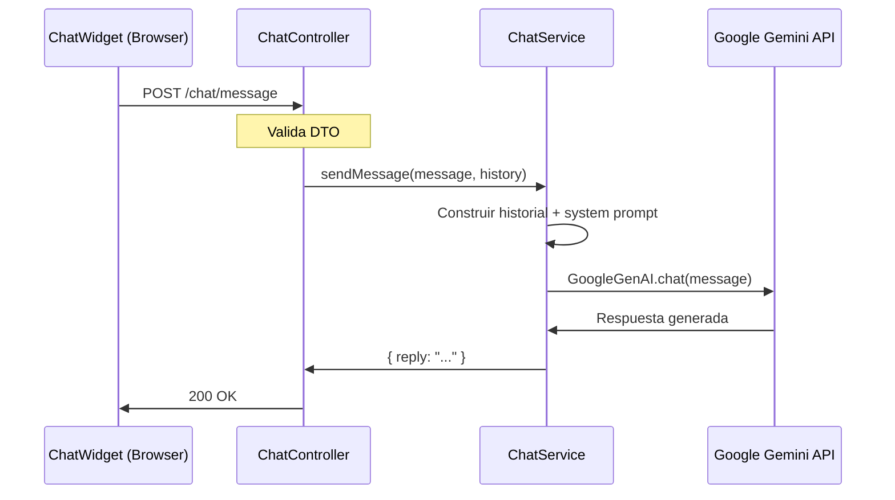

# API — Chat (Bot Gemini)

## Resumen

Endpoint que actúa como **proxy** entre el frontend y la API de Google Gemini. La API key se mantiene segura en el backend y nunca se expone al browser.

## Endpoint

### `POST /chat/message`

Envía un mensaje al bot de Gemini y retorna la respuesta generada.

**Request:**

```http
POST /chat/message
Content-Type: application/json

{
  "message": "¿Qué servicios ofrecen?",
  "history": [
    { "role": "user", "content": "Hola" },
    { "role": "assistant", "content": "¡Hola! Soy el asistente de Pidgeon Solutions..." }
  ]
}
```

### Campos del DTO

| Campo               | Tipo                    | Requerido | Descripción                             |
| ------------------- | ----------------------- | --------- | --------------------------------------- |
| `message`           | `string`                | Sí        | Mensaje del usuario                     |
| `history`           | `ChatMessage[]`         | No        | Historial de conversación para contexto |
| `history[].role`    | `'user' \| 'assistant'` | Sí        | Rol del mensaje                         |
| `history[].content` | `string`                | Sí        | Contenido del mensaje                   |

### Response (200 OK)

```json
{
  "reply": "¡Claro! En Pidgeon Solutions ofrecemos tres planes principales:\n\n1. **Entrepreneur** (US$100/mes) — Ideal para tu primera web profesional...\n2. **Small Business** (US$250/mes) — Para tiendas y servicios...\n3. **Custom System** (US$1,000+) — Sistemas a medida con CRM, ERP...\n\n¿Te interesa saber más sobre alguno?"
}
```

### Errores

| Status | Body                                            | Causa                            |
| ------ | ----------------------------------------------- | -------------------------------- |
| 400    | `{ "message": "El mensaje es requerido" }`      | Body vacío o sin campo `message` |
| 500    | `{ "message": "Error al procesar el mensaje" }` | Error de la API de Gemini        |

## Arquitectura



## System Prompt

El bot tiene un system prompt que lo configura como asistente de Pidgeon Solutions:

- **Rol:** Asistente de ventas y soporte técnico
- **Idioma:** Responde en el idioma del usuario (ES/EN)
- **Conocimiento:** Planes, precios, servicios, tecnologías, equipo
- **Personalidad:** Profesional, amigable, conciso
- **Limitaciones:** No inventa precios ni promete features que no existen

## Configuración

| Variable         | Valor                       |
| ---------------- | --------------------------- |
| `GEMINI_API_KEY` | API key de Google AI Studio |
| Modelo           | Configurable en el service  |

Obtener API key: [Google AI Studio](https://aistudio.google.com/)

## Seguridad

- La API key **nunca** llega al frontend
- El backend actúa como proxy encapsulando la lógica de Gemini
- Rate limiting recomendado para evitar abuso (TODO)
- Los mensajes no se persisten en el servidor (stateless)
- El historial se envía desde el cliente en cada request

## Pendiente (TODO)

- [ ] Rate limiting por IP (ej: 30 requests/minuto)
- [ ] Logging de conversaciones para analytics
- [ ] Streaming de respuestas (SSE / chunked responses)
- [ ] Fallback si Gemini no responde (mensaje predeterminado)
- [ ] Métricas de tokens consumidos

---

_Ver también:_ [Backend Architecture](../arquitectura/backend.md) · [Frontend Architecture](../arquitectura/frontend.md) · [Variables de Entorno](../guias/variables-entorno.md)
