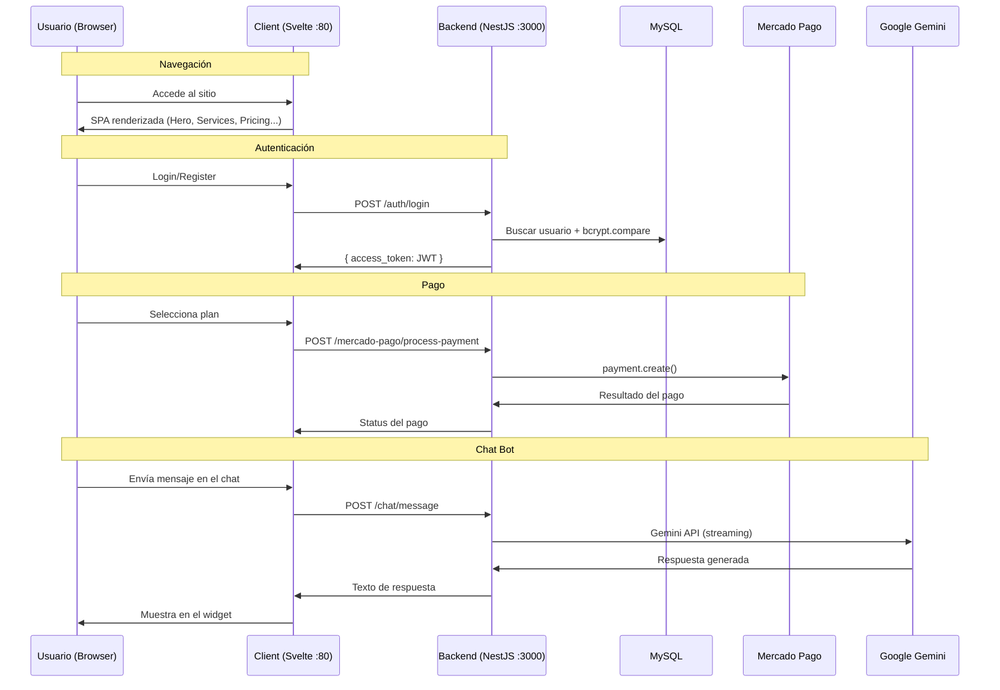

# Arquitectura General — Pidgeon Solutions

## Vista de Alto Nivel

Pidgeon Solutions es una aplicación web de 3 capas desplegada con Docker Compose.

```mermaid
graph TB
    subgraph "Docker Compose — pidgeon-net"
        subgraph "Client :80"
            NGINX[Nginx]
            SVELTE[Svelte 5 SPA]
        end

        subgraph "Backend :3000"
            NEST[NestJS API]
            AUTH[AuthModule]
            MP[MercadoPagoModule]
            CHAT[ChatModule]
        end

        subgraph "MySQL :3306"
            DB[(pidgeon_db)]
            USERS[users]
        end
    end

    BROWSER[🌐 Browser] -->|HTTP :80| NGINX
    NGINX --> SVELTE
    SVELTE -->|API calls :3000| NEST
    NEST --> AUTH
    NEST --> MP
    NEST --> CHAT
    AUTH -->|TypeORM| DB
    MP -->|SDK| MPAGO[Mercado Pago API]
    CHAT -->|@google/genai| GEMINI[Google Gemini API]

    style BROWSER fill:#1e293b,stroke:#10b981,color:#fff
    style GEMINI fill:#1a73e8,stroke:#4285f4,color:#fff
    style MPAGO fill:#009ee3,stroke:#009ee3,color:#fff
```

## Flujo de Datos



## Patrones de Diseño

### Backend: Feature-Based Modules

Cada dominio de negocio es un módulo NestJS independiente:

- **AuthModule** — Autenticación y autorización
- **MercadoPagoModule** — Procesamiento de pagos
- **ChatModule** — Bot de asistencia con Gemini

Cada módulo contiene: `*.module.ts`, `*.controller.ts`, `*.service.ts`, `dto/`, `entities/`.

→ Detalle en [backend.md](backend.md)

### Frontend: Store Pattern

Estado global manejado con Svelte stores:

- `lang` — Idioma activo (ES/EN)
- `t` — Traducciones derivadas del idioma
- `isContactModalOpen`, `isPaymentModalOpen` — Estado de modales

→ Detalle en [frontend.md](frontend.md)

### Infraestructura: Single-Command Deploy

Todo se levanta con `docker-compose up -d`. Tres contenedores en una red bridge compartida.

→ Detalle en [infraestructura.md](infraestructura.md)

## Estructura del Repositorio

```
pidgeon/
├── README.md                  ← Portal del proyecto
├── CLAUDE.md                  ← Contexto para Claude CLI
├── docker-compose.yml         ← Orquestación de servicios
├── docs/                      ← Documentación técnica (Doc as Code)
│   ├── README.md              ← Índice maestro
│   ├── arquitectura/          ← (este directorio)
│   ├── guias/
│   ├── api/
│   ├── integraciones/
│   ├── mcp/
│   └── claude/
├── backend/                   ← NestJS API
│   ├── Dockerfile
│   ├── package.json
│   └── src/
│       ├── main.ts
│       ├── app.module.ts
│       ├── auth/              ← Autenticación JWT
│       ├── db/                ← TypeORM entities y migraciones
│       ├── mercado-pago/      ← Integración de pagos
│       └── chat/              ← Bot Gemini (backend proxy)
├── client/                    ← Svelte 5 SPA
│   ├── Dockerfile
│   ├── package.json
│   ├── App.svelte
│   ├── stores.ts
│   ├── i18n.ts
│   └── components/
│       ├── Hero.svelte
│       ├── ServicesGrid.svelte
│       ├── ChatWidget.svelte  ← Widget flotante de chat
│       ├── FloatingActions.svelte
│       └── ...
└── .claude/
    └── agents/
        └── pidgeon-claude.agent.md
```

## Decisiones Técnicas Clave

| Decisión                   | Razón                                                          |
| -------------------------- | -------------------------------------------------------------- |
| NestJS sobre Express puro  | Estructura modular, DI nativo, decorators, ecosystem maduro    |
| Svelte 5 sobre React/Vue   | Reactividad nativa (runes), bundle pequeño, menos boilerplate  |
| MySQL sobre PostgreSQL     | Familiaridad del equipo, suficiente para el caso de uso actual |
| JWT sobre sessions         | Stateless, escalable, compatible con microservicios futuros    |
| Gemini en backend proxy    | API key segura, rate limiting centralizado, logging            |
| Docker Compose sobre K8s   | Simplicidad para etapa actual, migración futura si escala      |
| Markdown docs sobre Notion | Doc as Code — versionable, inyectable a agentes de IA          |

---

_Ver también:_ [Backend](backend.md) · [Frontend](frontend.md) · [Infraestructura](infraestructura.md)
