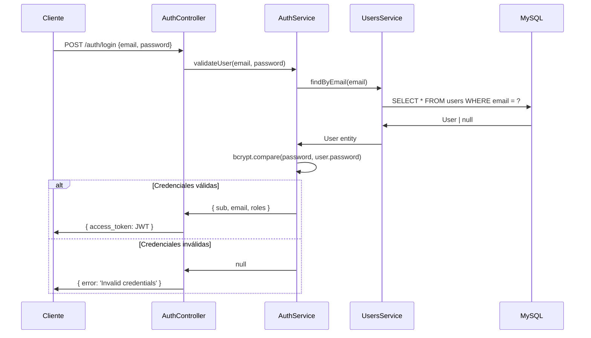

# Arquitectura del Backend — NestJS

## Stack

| Componente    | Tecnología              |
| ------------- | ----------------------- |
| Framework     | NestJS 10.x             |
| Lenguaje      | TypeScript 5.x          |
| ORM           | TypeORM 0.3.x           |
| Base de Datos | MySQL 8.0               |
| Auth          | Passport + JWT          |
| Hashing       | bcryptjs                |
| Pagos         | Mercado Pago SDK 2.12.x |
| IA            | @google/genai (Gemini)  |
| Config        | @nestjs/config (dotenv) |

## Estructura de Carpetas

```
backend/src/
├── main.ts                    ← Bootstrap: NestFactory.create, puerto 3000
├── app.module.ts              ← Módulo raíz: importa todos los módulos
├── auth/                      ← Módulo de autenticación
│   ├── auth.module.ts
│   ├── auth.controller.ts     ← POST /auth/login, /register
│   ├── auth.service.ts        ← validateUser, login, register
│   └── jwt.strategy.ts        ← Passport JWT strategy
├── db/                        ← Capa de datos
│   ├── data-source.ts         ← Configuración de TypeORM CLI
│   ├── users.service.ts       ← CRUD de usuarios
│   ├── entities/
│   │   └── user.entity.ts     ← Entidad User (UUID, email, password, roles)
│   └── migrations/
│       └── 1680000000000-CreateUsers.ts
├── mercado-pago/              ← Módulo de pagos
│   ├── mercado-pago.module.ts
│   ├── mercado-pago.controller.ts  ← POST /mercado-pago/process-payment
│   ├── mercado-pago.service.ts     ← Lógica de MercadoPago SDK
│   ├── dto/
│   │   ├── create-mercado-pago.dto.ts
│   │   └── update-mercado-pago.dto.ts
│   └── entities/
│       └── mercado-pago.entity.ts
└── chat/                      ← Módulo de chat (Bot Gemini)
    ├── chat.module.ts
    ├── chat.controller.ts     ← POST /chat/message
    ├── chat.service.ts        ← Lógica de Google Gemini
    └── dto/
        └── chat-message.dto.ts
```

## Módulo Raíz: AppModule

```typescript
// app.module.ts
@Module({
  imports: [
    ConfigModule.forRoot({ isGlobal: true }),
    TypeOrmModule.forRoot({
      type: "mysql",
      host: process.env.DB_HOST || "localhost",
      port: Number(process.env.DB_PORT || 3306),
      username: process.env.DB_USERNAME || "root",
      password: process.env.DB_PASSWORD || "",
      database: process.env.DB_DATABASE || "pidgeon_db",
      entities: [__dirname + "/db/entities/*{.ts,.js}"],
      migrations: [__dirname + "/db/migrations/*{.ts,.js}"],
      synchronize: process.env.TYPEORM_SYNC === "true",
    }),
    AuthModule,
    MercadoPagoModule,
    ChatModule,
  ],
})
export class AppModule {}
```

**Puntos clave:**

- `ConfigModule` es global — accesible en todos los módulos sin re-importar
- `synchronize: true` **solo en desarrollo** — en producción, usar migraciones
- Las entities y migrations se cargan por glob pattern

## Módulo de Autenticación

### Flujo de Login



### Flujo de Registro

1. Verificar que el email no existe
2. Hash del password con `bcrypt.hash(password, 10)`
3. Crear usuario en DB con roles `['user']`
4. Generar JWT y retornar `access_token`

### JWT Strategy

- Token extraído del header `Authorization: Bearer <token>`
- Payload: `{ sub: userId, email, roles }`
- Secret: variable de entorno `JWT_SECRET`
- Sin expiración explícita configurada (TODO: agregar `expiresIn`)

## Entidad User

```typescript
@Entity("users")
export class User {
  @PrimaryGeneratedColumn("uuid")
  id: string; // UUID v4

  @Column({ unique: true })
  email: string; // Índice único

  @Column()
  password: string; // Hash bcrypt (nunca en plain text)

  @Column({ type: "simple-array", default: "user" })
  roles: UserRole[]; // 'admin' | 'user'

  @CreateDateColumn()
  createdAt: Date;
}
```

## Módulo de Mercado Pago

- Inicializa `MercadoPagoConfig` con `MP_ACCESS_TOKEN` del entorno
- Endpoint único: `POST /mercado-pago/process-payment`
- DTO: `CreateMercadoPagoDto` con `transaction_amount`, `token`, `description`, `installments`, `payment_method_id`, `payer`
- **TODO pendiente:** Envío de email de confirmación en pagos aprobados

## Módulo de Chat (Gemini)

- **Propósito:** Backend proxy para el bot de asistencia al cliente
- **Seguridad:** La API key de Gemini (`GEMINI_API_KEY`) está en el backend, nunca se expone al browser
- Endpoint: `POST /chat/message`
- Usa `@google/genai` para llamar a Google Gemini
- System prompt con información de la empresa, servicios y precios

→ Detalle del endpoint en [docs/api/chat.md](../api/chat.md)

## Comandos Útiles

```bash
# Instalar dependencias
cd backend && pnpm install

# Desarrollo local (sin Docker)
pnpm run start:dev

# Build de producción
pnpm run build

# Correr migraciones
pnpm run migration:run

# Generar nueva migración
pnpm run migration:generate
```

## Convenciones

- **Módulos:** Un directorio por dominio de negocio bajo `src/`
- **DTOs:** Clases simples en `dto/` para validación de input
- **Entities:** Decoradas con TypeORM en `db/entities/`
- **Services:** Lógica de negocio, inyectables
- **Controllers:** Solo routing y delegación a services
- **Naming:** PascalCase para clases, camelCase para variables/métodos

---

_Ver también:_ [Vista General](README.md) · [Frontend](frontend.md) · [API Auth](../api/autenticacion.md) · [API Pagos](../api/pagos.md)
