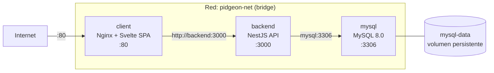

# Infraestructura — Docker Compose

## Visión General

El proyecto se despliega como 3 contenedores Docker orquestados por Docker Compose, conectados en una red bridge privada.



## Docker Compose

```yaml
services:
  backend:
    build:
      context: ./backend
      dockerfile: Dockerfile
      args:
        - NODE_ENV=production
    ports:
      - "3000:3000"
    env_file:
      - ./backend/.env
    networks:
      - pidgeon-net
    depends_on:
      - mysql

  client:
    build:
      context: ./client
      dockerfile: Dockerfile
      args:
        - VITE_API_URL=http://backend:3000
    ports:
      - "80:80"
    depends_on:
      - backend
    networks:
      - pidgeon-net

  mysql:
    image: mysql:8.0
    restart: unless-stopped
    environment:
      - MYSQL_ROOT_PASSWORD=***
      - MYSQL_DATABASE=pidgeon_db
      - MYSQL_USER=pidgeon
      - MYSQL_PASSWORD=***
    ports:
      - "3306:3306"
    volumes:
      - mysql-data:/var/lib/mysql
    networks:
      - pidgeon-net

networks:
  pidgeon-net:
    driver: bridge

volumes:
  mysql-data:
    driver: local
```

## Servicios

### 1. Client (Svelte + Nginx)

| Propiedad      | Valor                     |
| -------------- | ------------------------- |
| Puerto externo | 80                        |
| Puerto interno | 80                        |
| Base image     | Nginx (multi-stage build) |
| Build context  | `./client`                |
| Depende de     | backend                   |

**Build multi-stage:**

1. **Stage 1 (node):** Instala dependencias con pnpm, ejecuta `vite build`, genera archivos estáticos en `dist/`
2. **Stage 2 (nginx):** Copia los archivos estáticos, sirve la SPA

**Variable de build:** `VITE_API_URL` se inyecta en build-time para que el frontend sepa dónde está la API.

### 2. Backend (NestJS)

| Propiedad      | Valor                  |
| -------------- | ---------------------- |
| Puerto externo | 3000                   |
| Puerto interno | 3000                   |
| Base image     | Node.js                |
| Build context  | `./backend`            |
| Depende de     | mysql                  |
| Variables      | Desde `./backend/.env` |

**Variables de entorno requeridas** (en `backend/.env`):

```env
DB_HOST=mysql
DB_PORT=3306
DB_USERNAME=pidgeon
DB_PASSWORD=***
DB_DATABASE=pidgeon_db
JWT_SECRET=tu_secret_seguro
MP_ACCESS_TOKEN=tu_token_mercadopago
GEMINI_API_KEY=tu_api_key_gemini
TYPEORM_SYNC=false
```

> **Nota:** Dentro de Docker, `DB_HOST=mysql` usa el nombre del servicio como hostname (resuelto por la red bridge).

### 3. MySQL 8.0

| Propiedad      | Valor                    |
| -------------- | ------------------------ |
| Puerto externo | 3306                     |
| Puerto interno | 3306                     |
| Imagen         | mysql:8.0                |
| Restart policy | unless-stopped           |
| Volumen        | mysql-data (persistente) |

**Base de datos:** `pidgeon_db` se crea automáticamente al iniciar el contenedor.

**Volumen:** `mysql-data` persiste los datos entre reinicios de contenedores. Los datos **no se pierden** al hacer `docker-compose down`, solo con `docker-compose down -v`.

## Red: pidgeon-net

- **Driver:** bridge (default de Docker)
- **Resolución DNS:** Cada servicio puede referirse a los demás por nombre (`mysql`, `backend`, `client`)
- **Aislamiento:** Los servicios solo se comunican entre sí dentro de esta red
- **Puertos expuestos:** Solo `:80` y `:3000` son accesibles desde el host (`:3306` también, pero solo para desarrollo — en producción, cerrar)

## Comandos Principales

```bash
# Levantar todo
docker-compose up -d

# Ver logs
docker-compose logs -f
docker-compose logs -f backend

# Rebuild tras cambios
docker-compose up -d --build

# Detener todo (preserva datos)
docker-compose down

# Detener y eliminar volúmenes (⚠️ BORRA DATOS)
docker-compose down -v

# Ver estado
docker-compose ps

# Entrar a un contenedor
docker-compose exec backend sh
docker-compose exec mysql mysql -u pidgeon -p pidgeon_db
```

## Consideraciones de Producción

### Seguridad

- [ ] Cambiar contraseñas por defecto de MySQL
- [ ] Usar secrets de Docker o vault para variables sensibles
- [ ] Cerrar puerto 3306 al exterior (solo accesible internamente)
- [ ] Agregar HTTPS con certificado SSL (reverse proxy o Cloudflare)
- [ ] Configurar CORS restrictivo en NestJS

### Performance

- [ ] Agregar health checks a los servicios
- [ ] Configurar restart policies apropiadas
- [ ] Cache de Nginx para assets estáticos
- [ ] Límites de memoria/CPU por contenedor

### Monitoreo

- [ ] Logging centralizado (ELK stack o similar)
- [ ] Métricas de contenedores (Prometheus + Grafana)
- [ ] Alertas de uptime

---

_Ver también:_ [Vista General](README.md) · [Variables de Entorno](../guias/variables-entorno.md) · [Despliegue](../guias/despliegue.md)
