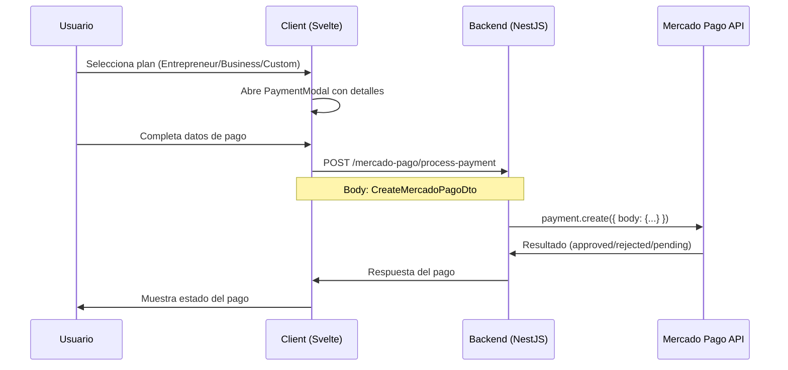

# Integración de Pagos — Mercado Pago

## Resumen

Pidgeon Solutions utiliza **Mercado Pago** como pasarela de pagos principal. La integración usa el SDK oficial (`mercadopago` v2.12.x) desde el backend NestJS.

## Flujo Completo



## Planes y Precios

| Plan           | Precio Mensual | Precio Anual | Descripción                                        |
| -------------- | -------------- | ------------ | -------------------------------------------------- |
| Entrepreneur   | US$ 100/mo     | US$ 1,000/yr | Landing page, formulario, dominio, hosting         |
| Small Business | US$ 250/mo     | US$ 2,500/yr | Multi-página, e-commerce (50 productos), blog, SEO |
| Custom System  | US$ 1,000+     | A cotizar    | CRM/ERP custom, API integrations, automation       |

> **Oferta de lanzamiento:** 30% OFF en el primer sitio web.

## Endpoint

```
POST /mercado-pago/process-payment
Content-Type: application/json
```

### Request Body (CreateMercadoPagoDto)

```json
{
  "transaction_amount": 100,
  "token": "token_generado_por_cardform",
  "description": "Plan Entrepreneur - Pidgeon Solutions",
  "installments": 1,
  "payment_method_id": "visa",
  "payer": {
    "email": "cliente@email.com",
    "identification": {
      "type": "DNI",
      "number": "12345678"
    }
  }
}
```

### Response

```json
{
  "id": 1234567890,
  "status": "approved",
  "status_detail": "accredited",
  "transaction_amount": 100,
  "currency_id": "ARS",
  "payment_method_id": "visa"
}
```

### Posibles Estados

| Status       | Significado                    |
| ------------ | ------------------------------ |
| `approved`   | Pago aprobado y acreditado     |
| `pending`    | Pago pendiente de confirmación |
| `rejected`   | Pago rechazado                 |
| `in_process` | En revisión por Mercado Pago   |

## Configuración

### Variable de Entorno

```env
MP_ACCESS_TOKEN=APP_USR-xxxx-xxxx-xxxx
```

Obtener el token en: [Mercado Pago Developers](https://www.mercadopago.com.ar/developers/panel)

### Entornos

- **Test:** Usar credenciales de test (`TEST-xxxx`) con tarjetas de prueba
- **Producción:** Usar credenciales de producción (`APP_USR-xxxx`)

### Tarjetas de Prueba (Argentina)

| Tarjeta               | Número              | CVV | Vencimiento |
| --------------------- | ------------------- | --- | ----------- |
| Visa (aprobada)       | 4509 9535 6623 3704 | 123 | 11/25       |
| Mastercard (aprobada) | 5031 7557 3453 0604 | 123 | 11/25       |
| Visa (rechazada)      | 4000 0000 0000 0036 | 123 | 11/25       |

## Implementación Backend

### Service (`mercado-pago.service.ts`)

```typescript
@Injectable()
export class MercadoPagoService {
  private client: MercadoPagoConfig;

  constructor() {
    this.client = new MercadoPagoConfig({
      accessToken: process.env.MP_ACCESS_TOKEN || ''
    });
  }

  async processPayment(dto: CreateMercadoPagoDto) {
    const payment = new Payment(this.client);
    return payment.create({ body: { ... } });
  }
}
```

### Controller (`mercado-pago.controller.ts`)

```typescript
@Controller("mercado-pago")
export class MercadoPagoController {
  @Post("process-payment")
  processPayment(@Body() dto: CreateMercadoPagoDto) {
    return this.mercadoPagoService.processPayment(dto);
  }
}
```

## Pendiente (TODO)

- [ ] Email de confirmación al pagar (Resend/SendGrid)
- [ ] Webhook de notificaciones de Mercado Pago
- [ ] Integración con PayPal (código preparado, desactivado)
- [ ] Integración con Stripe (código preparado, desactivado)
- [ ] Historial de pagos en el dashboard admin

## Pasarelas Futuras

El código tiene preparaciones para PayPal y Stripe, pero están **desactivadas** por ahora. Se activarán cuando el volumen de clientes internacionales lo justifique.

---

_Ver también:_ [API Pagos](../api/pagos.md) · [Variables de Entorno](../guias/variables-entorno.md) · [Roadmap](../roadmap.md)
